 

 

  

 
🔭 What I'm Up To
<table> <tr> <td width="22%"><b>💻 Building</b></td> <td>Developing scalable, modern full-stack web applications.</td> </tr> <tr> <td width="22%"><b>🧰 Exploring</b></td> <td>Adopting emerging technologies and modern development tools.</td> </tr> <tr> <td width="22%"><b>🧠 Strengthening</b></td> <td>Sharpening problem-solving skills and coding practices.</td> </tr> <tr> <td width="22%"><b>🌍 Delivering</b></td> <td>Creating practical software that solves real-world problems.</td> </tr> <tr> <td width="22%"><b>🚀 Committed to</b></td> <td>Continuous learning, experimentation, and professional growth.</td> </tr> </table> 
🧠 Tech Stack

    

Also: Bash · Ubuntu · Dart · Android Studio · Cisco Packet Tracer

 
📂 Featured Projects
<table> <tr> <td width="50%" valign="top"> <h3><a href="https://github.com/abdullahamjad20/Abdullahz_portfolio">📁 Abdullahz_portfolio</a></h3> 
My personal portfolio website.
      </td> <td width="50%" valign="top"> <h3><a href="https://github.com/abdullahamjad20/Summer-Projects-2026">📁 Summer-Projects-2026</a></h3> 
Web development summer projects.
      </td> </tr> <tr> <td width="50%" valign="top"> <h3><a href="https://github.com/abdullahamjad20/student-registartion-form">📁 student-registartion-form</a></h3> 
A student registration form.
      </td> <td width="50%" valign="top"> <h3><a href="https://github.com/abdullahamjad20/Advance-Database-System-">📁 Advance-Database-System-</a></h3> 
Advanced Database Systems lab tasks.
      </td> </tr> <tr> <td width="100%" valign="top" colspan="2"> <h3><a href="https://github.com/abdullahamjad20/work_shop-spring_2026-">📁 work_shop-spring_2026-</a></h3> 
Spring 2026 workshop (forked).
      </td> </tr> </table> 
🐍 Contribution Snake

  
 
📫 Let's Connect

Have an idea, an internship opportunity or just want to say hi? My inbox is open.

 

 

 

